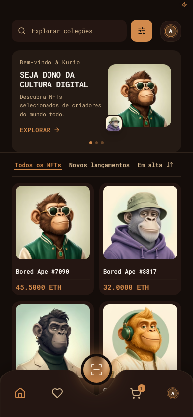
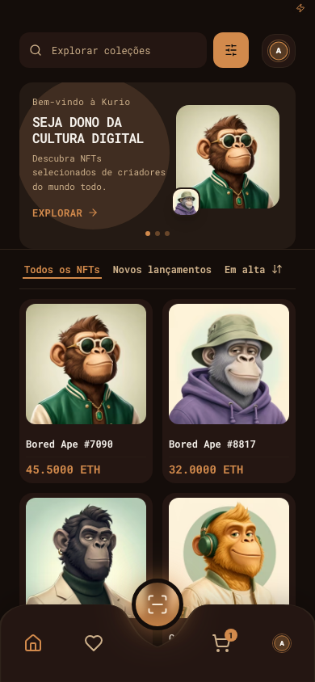

# Validação

Resultados finais executados em 2026-10-20 no checkout local. O trabalho local que já existia foi preservado; nenhuma publicação foi feita.

## Verificações de código

| Comando | Resultado |
|---|---|
| `npm run typecheck` | PASS, sem erros de TypeScript |
| `npm run lint` | PASS, sem erros |
| `npm run build` | PASS, 2140 módulos transformados |
| `git diff --check` | PASS, sem problemas de whitespace |

## Playwright

- E2E final: **84/84 PASS**, 28 cenários em Chromium desktop 1440×900, mobile 390×844 e tablet 768×1024. Revalidado em 2026-10-20.
- Inclui preço/estoque alterados por Socket.IO, checkout bloqueado para cotação antiga, pedidos pendentes confirmados/recusados, replay duplicado/antigo e recuperação após desconexão/reload. Os testes aguardam o handshake do cliente antes de emitir eventos; o teste de detalhe verifica a avaliação mock exibida.
- Cenários acrescentados: filtros combinados após refresh, conflito 409 de idempotência, sessão 401 durante checkout mantendo o carrinho, cupons inválido/expirado, alteração de senha e remoção de carteira.
- Regressão visual: **25/25 PASS** — 4 baselines desktop e 21 casos responsivos em mobile 390×844, tablet 768×1024 e desktop 1920×1080; inclui início, detalhe, carrinho, checkout, perfil, carteiras e recibo. Screenshots comparados aos baselines versionados com tolerância máxima de 5% de pixels. Os baselines de detalhe mobile e tablet foram atualizados para refletir a nota ao lado do nome.
- A comparação manual com os PNGs Figma confirma proximidade de geometria; ela não é uma medição automatizada de diferença pixel a pixel contra o Figma.

## Lighthouse

Três medições por tela/perfil; a tabela usa medianas da revalidação de 2026-10-20. Os relatórios HTML/JSON completos e o resumo estão em [`lighthouse-reports/adversarial-recheck-2026-10-20/`](../../lighthouse-reports/adversarial-recheck-2026-10-20/). Reproduza com `LIGHTHOUSE_REPORTS_DIR=/tmp/kurio-lighthouse npm run lighthouse`.

| Rota | Perfil | Performance | A11y | Best Practices | SEO | LCP | CLS | TBT |
|---|---|---:|---:|---:|---:|---:|---:|---:|
| Início | Mobile | 92 | 100 | 100 | 100 | 3163 ms | 0 | 10 ms |
| Início | Desktop | 100 | 100 | 100 | 100 | 716 ms | 0 | 0 ms |
| Detalhe NFT | Mobile | 94 | 100 | 100 | 100 | 2872 ms | 0 | 4 ms |
| Detalhe NFT | Desktop | 100 | 100 | 100 | 100 | 694 ms | 0 | 0 ms |

Perfil mobile usa 390×844 e DPR 2; Lighthouse executado no build de produção. As medianas de Performance passaram a meta 90 nas quatro combinações. O ambiente de execução está registrado nos relatórios JSON/HTML.

## Capturas

Comparação viewport 390×844 antes/depois do ajuste do hero mobile, com a mesma conta de demonstração:

| Antes | Depois |
|---|---|
|  |  |

As imagens de referência originais do Figma ficam no workspace local e foram excluídas do repositório a pedido do usuário.

As regressões visuais adicionais incluem [detalhe](../../tests/visual/snapshots/responsive-visual.spec.ts-snapshots/responsive-detail-Mobile-Visual-darwin.png), [carrinho](../../tests/visual/snapshots/responsive-visual.spec.ts-snapshots/responsive-cart-Mobile-Visual-darwin.png), [checkout](../../tests/visual/snapshots/responsive-visual.spec.ts-snapshots/responsive-checkout-Mobile-Visual-darwin.png), [perfil](../../tests/visual/snapshots/responsive-visual.spec.ts-snapshots/responsive-profile-Mobile-Visual-darwin.png), [carteiras](../../tests/visual/snapshots/responsive-visual.spec.ts-snapshots/responsive-wallets-Mobile-Visual-darwin.png) e [recibo](../../tests/visual/snapshots/responsive-visual.spec.ts-snapshots/responsive-receipt-Mobile-Visual-darwin.png).
